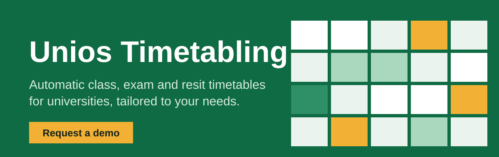
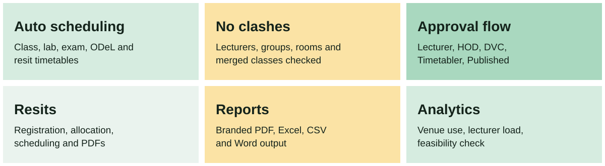
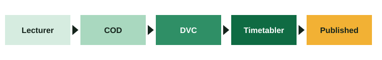
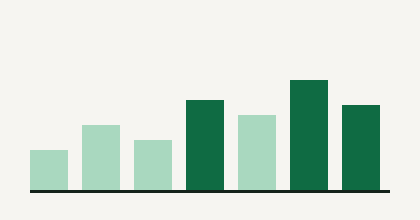

## Timetables and exams that schedule themselves

Unios Timetabling builds clash-free class, lab, exam and resit timetables for your whole university. Each department reviews and approves its part, and the final timetable is published as a branded PDF.

Built for every university. We configure it around your calendar, structure, rules and branding.

## Request a demo

Tell us your university and what you need. We will show you a live demo and send a proposal.

## An approval flow your university already knows

Course allocation moves from lecturer to head of department to the DVC, then to the timetabler, and out to everyone as a published PDF. Everyone involved is notified at each step.

## What is included

**Scheduling.** Regular, lab, exam, distance learning (ODeL), resit and multi-campus timetables. Automatic generation with manual editing when you want control. Lecturer time and venue preferences, blocked slots, special requests, and scheduling rules you can switch on or off.

**People and workflow.** Roles for administrators, DVC, deans, heads of department, directors, timetablers, lecturers, class representatives, students and analysts. Notifications, announcements and an audit trail of every action.

**Resits.** Student registration, departmental allocation, automatic or manual scheduling and published resit PDFs.

**Data and reports.** Bulk import and export with Excel and CSV, branded PDF, Word and CSV output, rooms and venues with capacities and specialisations.

**Insight.** Analytics on venue use, lecturer load and student numbers, plus a feasibility check that tells you whether your data can be scheduled before you start.

**Reliability.** Mobile app, offline desktop app for timetablers, scheduled backups, disaster-recovery settings and in-system help.

## Tailored to you

We configure the academic calendar, faculty and department structure, approval workflow, scheduling rules, branding and PDF layouts, and import your existing courses, lecturers, venues and students.

How we work with you: discovery call, demo, pilot with your own data, tailoring, training and go-live, then ongoing support. Pricing is quoted by institution size and the modules you need.

## Contact

WhatsApp: [0758 067 458](https://wa.me/254758067458)

Email: [dravtech@gmail.com](mailto:dravtech@gmail.com)

CTO: [samuelkibunja55@gmail.com](mailto:samuelkibunja55@gmail.com)

The Unios Timetabling software is proprietary. This profile is a product presentation only and contains no source code. © 2026 DravTech. All rights reserved.
